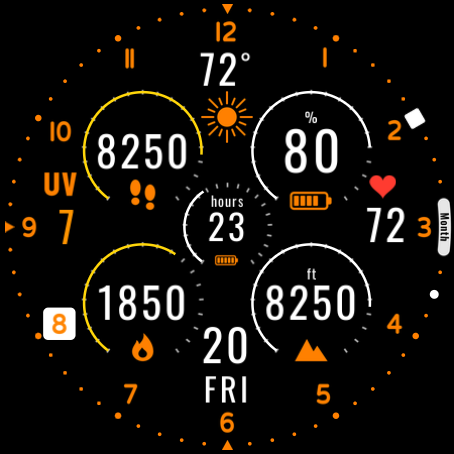
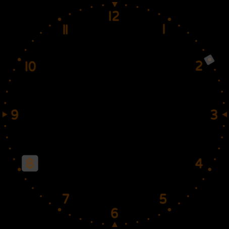

# Night Digital for Wear OS

Digital watch face for the Google Pixel Watch 5 (Wear OS 7). It runs on any round Wear OS 6
or later watch. It is the digital companion to
[Night Dial](https://github.com/ls6777/NightDial), with the same readings and data sources.

It is built with the [Watch Face Format](https://developer.android.com/training/wearables/wff)
(version 4), which Google requires for watch faces.

> **Work in progress:** this project starts as a copy of Night Dial 4.1.0. The digital layout
> hasn't been built yet, so the face, the pictures and the description below are still Night
> Dial's.

<p align="center">
  
  
</p>

*The Wear OS 7 emulator. Left: the test build (`./build.sh test`) at its fixed time of
8:10:18, with its sample readings (72°F and clear, UV 7, 80% battery, 23 hours left, 8,250
steps, 1,850 calories, 8,250 ft, a heart rate of 72, Friday the 20th of March). Right:
always-on mode.*

## The face

- **Dial:** an orange ring at the edge of the face: a dot for every minute, larger at the
  hours, and a triangle pointing inward at 12, 3, 6 and 9. Small orange hour numerals 1 to
  12 sit just inside it.
- **Hour:** a solid white box with round corners behind the current hour's orange
  numeral.
- **Minute:** a small solid white square with round corners across the ring at the current
  minute, on a black backing that covers the dot under it. It moves a minute at a time.
- **Second:** a white dot, larger than the hour dots, over the ring's dot at the current
  second (at 12, 3, 6 and 9, the ring's triangle in white instead). It has a thin black
  outline and sits over everything else there, the minute square and the month band
  included.
- **Readings:** the values (gauges, temperature, heart rate, UV and date) are in white
  Oswald and show "--" without data.
- **Weather:** at the top, just below the 12, from the watch's weather data: the
  temperature (red above 90°F, blue below 40°F) with a small degree sign and no unit (the
  watch's own setting), and below it an orange icon for the condition (night versions
  after dark). Without weather data, the sun and "--°".
- **Heart rate:** left of the 3: a red heart above the rate, from the watch's heart rate
  sensor. The rate is right-aligned, so two digits sit as close to the 3 as three.
- **UV index:** right of the 9, mirroring the heart rate: an orange "UV" above the index,
  in the WHO scale's colors (green, yellow, orange, red, violet).
- **Date:** above the 6: the day of the month, and below it the day's first three letters
  (SUN to SAT).
- **Gauges:** four rings of gray tick marks, open at the bottom, each with a progress bar
  through the middle of its ticks, its value large in the middle and its orange icon
  below. The value is as large as fits its digits: up to three digits at the largest
  size, four and five smaller, so 25,000 steps still fit. A unit, if any, sits small above
  the value.
  - **Steps** (10:30): today's steps, with footprints, the bar full at 10,000: red below
    30%, yellow to 90%, green from there. The number turns green once it reaches the step
    goal. They come from the Google Health app's steps complication, as on DataDial.
  - **Calories** (7:30): today's calories, with a flame, the bar full at 3,000, in the same
    colors. Watch Face Format can't read calories itself, so they come from the Google
    Health app's calories complication, as on DataDial.
  - **Elevation** (4:30): the elevation in feet, with "ft" above and a mountain, the bar
    full at 10,000 ft, in white. It comes from DataDial's companion app, DataDial Stats
    (barometric elevation), which must be installed on the watch. DataDial Stats sends
    meters in regions that use metric units, which this gauge doesn't read.
  - **Battery** (1:30): the battery percentage, with "%" above, from the watch. The bar is
    white, red below 20%. Below the number is an orange battery with a segment lit for
    every 20% (rounded up), red below 20%.
- **Battery time:** a smaller ring in the middle of the face, laid out like the other
  gauges: the hours of battery left in the middle, "hours" above them and a small battery
  low in the ring's opening. The bar is full at 100 hours, a tick every 5 hours, white, red below 8 hours. The
  hours come from DataDial Stats (DataDial 1.1.1 or later), which learns how this watch's
  battery drains from its own use: by hour of the day, by battery level (batteries don't
  drain evenly) and by what the watch is doing now, getting better the longer it runs. While
  charging, or in its first hour or two unplugged after it starts learning, "--".
- **Month:** a light gray band on the ring over the current month's numeral (1 for January
  to 12 for December), from the minute dot before it to the one after, with "Month" in
  black along it.
- **Always-on mode:** the dimmed ring, numerals, hour box and minute square; no second
  dot, readings, gauges or month.

## How it's built

Watch Face Format is declarative XML with no code. The layout is computed from the screen
radius, so `tools/generate.py` writes the XML and renders the images with Pillow: each is
drawn large, saved as a master in `build/masters/` for review, and scaled down to screen
size. Edit the script, not the generated files.

| File | Purpose |
|---|---|
| `tools/generate.py` | Writes `res/raw/watchface.xml` and the images in `res/drawable/` |
| `tools/fonts/` | Varela Round for the hour numerals, and Oswald for the gauges and readings (both SIL Open Font License) |
| `build.sh` | Generate, check, build, install, test build, release, runtime log |
| `watchface/src/main/AndroidManifest.xml` | Package, Watch Face Format version 4, no code |
| `watchface/src/main/res/raw/watchface.xml` | The watch face (generated) |
| `watchface/src/main/res/xml/watch_face_info.xml` | Preview image and picker settings |
| `watchface/src/main/res/values/strings.xml` | Names shown in the picker and editor |
| `watchface/src/main/res/drawable/preview.png` | Picker and store preview (an emulator capture of the test build) |
| `docs/night-digital-face.png`, `docs/night-digital-face-ambient.png` | The pictures above (emulator captures of the test build, awake and in always-on mode) |

## Build

Needs Android Studio (for its JDK; the Android SDK with API 36 platform and build tools), and
Python 3 with Pillow.

```sh
./build.sh          # generate and build the debug APK
./build.sh run      # also install it on the watch or emulator and make it the active face
./build.sh test     # the same with the time frozen and sample weather, UV, battery, date, month, heart rate, steps, calories, elevation and battery time, to check the layout
./build.sh release  # signed release APK (for GitHub releases) and bundle (.aab, for Google Play)
./build.sh log      # the watch face runtime's log: XML and expression errors show up here
```

`./build.sh test` writes the normal XML back when it's done, so the frozen time never stays
in the source. Run `./build.sh run` afterwards to put the live face back on the watch.

Every build runs Google's Watch Face Format checks, and stops if either fails:

- **Validator:** checks `watchface.xml` against the format version in the manifest.
- **Memory footprint:** checks the APK against the limits Google Play's review uses (10 MB in
  always-on mode, 100 MB awake).

`build.sh` downloads both tools (`wff-validator.jar` and `memory-footprint.jar`, from
[google/watchface](https://github.com/google/watchface/releases)) to `build/tools/` the first
time. Delete that folder to get the latest versions.

### Release signing

`./build.sh release` needs your release key and won't fall back to the debug key. Create the
key once, and keep the keystore and its passwords out of this repo:

```sh
keytool -genkeypair -keystore ~/keys/nightdigital-release.jks -alias nightdigital \
    -keyalg RSA -keysize 4096 -validity 10000
```

(`keytool` is in Android Studio's `jbr/bin`.) Then add to `~/.gradle/gradle.properties`:

```properties
nightdigital.keystore=C:/Users/<you>/keys/nightdigital-release.jks
nightdigital.keystorePassword=...
nightdigital.keyAlias=nightdigital
nightdigital.keyPassword=...
```

The environment variables `NIGHTDIGITAL_KEYSTORE`, `NIGHTDIGITAL_KEYSTORE_PASSWORD`,
`NIGHTDIGITAL_KEY_ALIAS` and `NIGHTDIGITAL_KEY_PASSWORD` work too. Back up the keystore: updates
must be signed with the same key, or users have to uninstall the face to install them.

The project also opens in Android Studio, which checks the watch face XML as you edit it.

## Run on the emulator or the watch

- **Emulator:** create a Wear OS 7 large round device (Device Manager in Android Studio, or
  `avdmanager create avd -k "system-images;android-37.0;android-wear-signed;x86_64" -d wearos_large_round`),
  start it, then `./build.sh run`.
- **Pixel Watch 5:** turn on Developer options (Settings → System → About → Versions, tap
  Build number seven times), then Developer options → Wireless debugging → Pair new device.
  On the PC: `adb pair <ip>:<port>` with the shown code, then `adb connect <ip>:<port>` with
  the port shown on the Wireless debugging screen, and `./build.sh run`.

A watch face changed with `./build.sh run` keeps its settings. To get the defaults again,
uninstall it first (`adb uninstall io.github.ls6777.nightdigital`).
